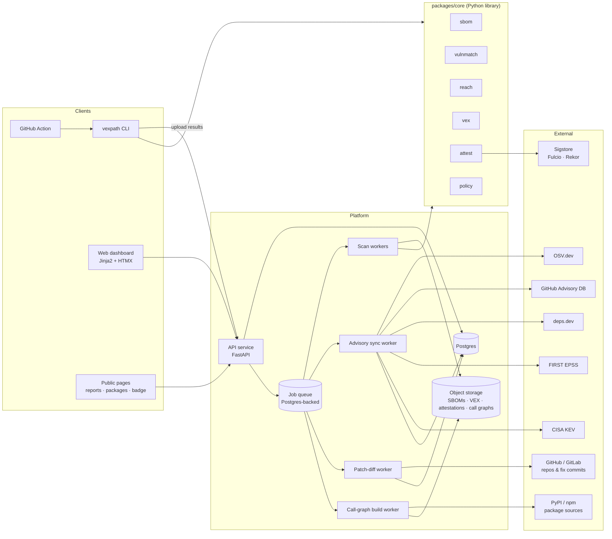
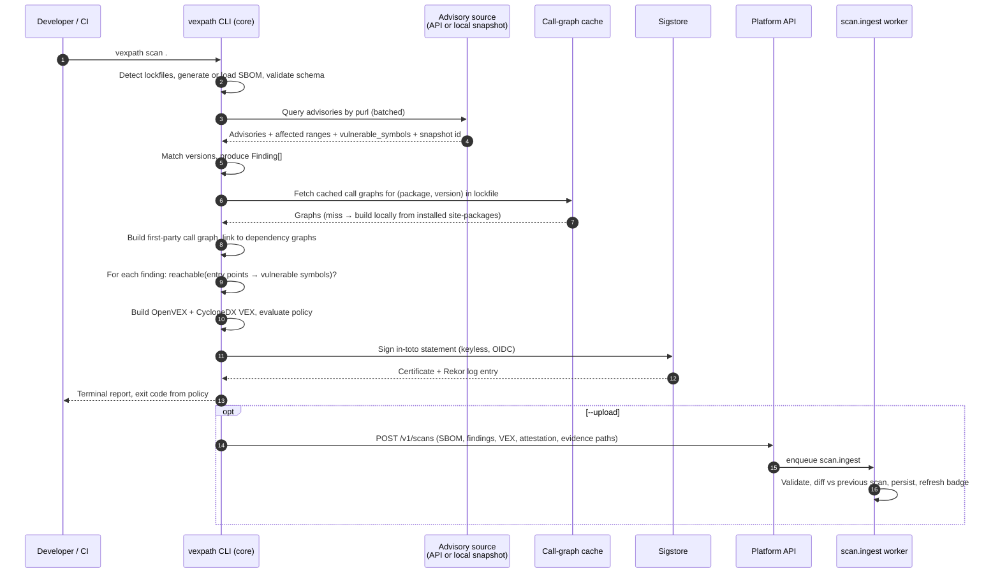
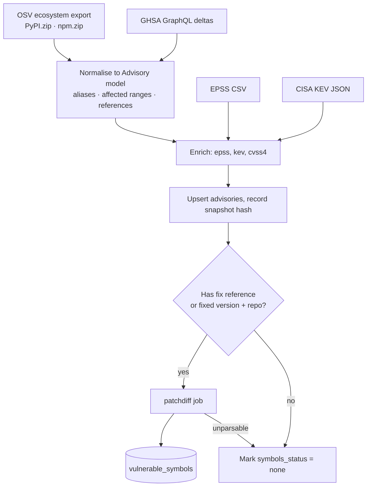

# 01 · System Architecture

## 1. Architecture at a glance

The platform is a **library-first** system. All analysis logic lives in one Python package (`packages/core`) that is used identically by the CLI, the GitHub Action, and the hosted workers. The hosted platform adds persistence, accounts, history, and public pages around that core. Nothing the web platform does is required to get a correct verdict locally; the hosted service is a convenience and a record, never a gatekeeper.



Two execution modes share the same core:

| Mode | Where analysis runs | What the platform stores |
|---|---|---|
| **Local / CI** (default) | On the developer's machine or CI runner via the CLI | Results are optionally uploaded: findings, VEX, attestation, call-path evidence. Source code never leaves the runner. |
| **Hosted scan** | In a sandboxed worker that clones the repository | Same, plus the worker needs read access to the repo (GitHub App installation token). |

The local mode is primary. It is faster to build, avoids holding customer source code, and matches how security-conscious teams want to operate. Hosted scanning is for the public "paste a GitHub URL" demo and for teams that opt in.

## 2. Component responsibilities

### 2.1 `packages/core` — the analysis library

Pure Python 3.12+, no framework dependencies, fully usable offline given an advisory snapshot. Sub-packages:

| Module | Responsibility | Key inputs → outputs |
|---|---|---|
| `core.sbom` | Parse, validate, normalise and generate SBOMs | File or repo → `Sbom` model (components with purl, version, relationships, hashes) |
| `core.vulnmatch` | Resolve components to advisories | `Sbom` + advisory source → `Finding[]` (component × advisory × affected range) |
| `core.reach` | Call-graph construction and reachability queries | Repo path + lockfile + `VulnerableSymbol[]` → `ReachabilityResult` per finding |
| `core.vex` | Produce OpenVEX and CycloneDX VEX | `Finding[]` + `ReachabilityResult[]` → VEX document |
| `core.attest` | Build in-toto Statements, sign and verify with Sigstore | artefact bytes → DSSE envelope + Rekor entry |
| `core.policy` | Evaluate CEL policies against findings | `Finding[]` + policy text → `PolicyResult` (pass/fail + violations) |
| `core.advisory` | Advisory data access: live API client, local snapshot cache, normalisation of OSV/GHSA records | ecosystem + purl → `Advisory[]` |
| `core.report` | Human-readable rendering: terminal table, Markdown (PR comment), SARIF | results → text |

Design rules for core:
- Every public function is deterministic given its inputs. Time and network are injected (an `AdvisorySource` protocol, a `Clock`).
- Models are Pydantic v2 and are the single schema for API responses, CLI JSON output and database rows.
- No module imports from `apps/`.

### 2.2 `packages/cli` — `vexpath`

Thin Typer application over core. Commands are specified in `04-api-and-cli.md`. Outputs JSON on `--format json` so the Action and other tooling can consume it. Reads `.vexpath.yml` from the repo root for policy, entry points and ignore rules.

### 2.3 `apps/api` — FastAPI service

- REST API, OpenAPI 3.1 spec generated and committed.
- Auth: session cookies for the web app (GitHub OAuth login), bearer API keys for CLI/Action (`vexpath_live_…`, hashed at rest), GitHub App installation tokens for hosted scans.
- Enqueues jobs; never does heavy work in-request.
- Serves the badge endpoint with edge-cacheable responses (`Cache-Control`, ETag).
- Emits audit-log rows for every mutating call.

### 2.4 `apps/worker` — background jobs

A single worker binary with job types, scaled by process count:

| Job | Trigger | What it does |
|---|---|---|
| `advisory.sync` | Cron (every 6 h) | Pull OSV ecosystem exports (zip per ecosystem from the OSV GCS bucket), GHSA GraphQL deltas, EPSS daily CSV, KEV JSON. Upsert into `advisories`. Record a `advisory_snapshots` row with the content hash so scans are reproducible. |
| `advisory.patchdiff` | After sync, for new advisories with fix references | Clone the upstream repository shallowly at the fix commit, diff against parent, map hunks to function definitions, write `vulnerable_symbols`. See `03-reachability-design.md § 3`. |
| `callgraph.build` | On demand, cached by (ecosystem, package, version) | Download the exact sdist/wheel or npm tarball, build the package's internal call graph, store in object storage. |
| `scan.hosted` | API request | Clone target repo in sandbox, run the same pipeline the CLI runs, upload results. |
| `scan.ingest` | CLI upload | Validate uploaded results, compute diff against previous scan on the same project/branch, persist, update badge cache. |

Queue: Postgres-backed (`procrastinate`) to keep infrastructure to a single database (ADR-0003).

### 2.5 Web UI — Jinja2 templates inside `apps/api` (ADR-0011)

There is no separate front-end application. The same FastAPI process serves JSON under `/v1/*` and server-rendered HTML everywhere else, sharing one service layer.

- Templates in Jinja2; interactivity through HTMX attributes returning HTML fragments from the same handlers. No JavaScript is authored in this repository.
- Styling with Tailwind compiled by the standalone Tailwind binary (no Node); the built stylesheet is committed.
- Authenticated dashboard: projects, scans, findings with evidence paths, policy editor, API keys.
- Public, SEO-indexable pages:
  - `/r/{org}/{project}` report page (opt-in public)
  - `/p/{ecosystem}/{package}` package page: advisory history, which symbols were affected per advisory, how many public projects reach them
  - `/badge/{org}/{project}.svg` served directly
- Docs site under `/docs`, rendering the Markdown in `docs/`.
- Call-path viewer and charts are server-rendered HTML and inline SVG produced by `core.report`, the same module behind the terminal output and PR comments.

### 2.6 `apps/action` — GitHub Action

Its `action.yml` is at the **repository root**, not in this directory: GitHub lists an action only when the metadata sits in the root of its repository. The README, the tests and everything else about the action stay here.

Docker-based action pinning a specific CLI version. Inputs: `policy`, `fail-on`, `upload`, `sbom-path`. Outputs: Checks API annotations (via SARIF upload to Code Scanning) and an optional PR comment rendered by `core.report`. Uses the runner's OIDC token for keyless Sigstore signing, so attestations carry the workflow identity.

## 3. Data flow: one scan, end to end



Verdict rules applied in step 9 are defined in `03-reachability-design.md § 5` and are the same for every mode.

## 4. Advisory pipeline



Fix-commit discovery, in order of preference:
1. OSV `references[].type == "FIX"` pointing at a commit URL.
2. OSV `affected[].ranges[].type == "GIT"` with an `introduced`/`fixed` event, repo from the range.
3. GHSA references matching `/commit/` or `/pull/` URLs (pull requests resolved to merge commits via the GitHub API).
4. Fallback: diff the fixed version's release tag against the last affected version's tag. Lower confidence; flagged as `derived_from_tags`.

Coverage of each tier is tracked as a metric from M1 onward, because the usefulness of the whole product depends on it.

## 5. Repository layout (monorepo)

```
.
├── apps/
│   ├── api/                 FastAPI app: /v1 JSON routers + HTML routers, templates/, static/
│   ├── worker/              Job modules; procrastinate app from M1
│   └── action/              action.yml, Dockerfile, entrypoint (M5)
├── packages/
│   ├── core/                vexpath_core: models/ ids purl enums protocols snapshot,
│   │                        then sbom/ advisory/ vulnmatch/ reach/ vex/ attest/ policy/ report/
│   ├── platform/            vexpath_platform: settings, logging, object storage
│   ├── db/                  vexpath_db: SQLAlchemy tables, engine helpers, Alembic migrations
│   └── cli/                 vexpath: Typer commands
├── infra/
│   ├── docker-compose.yml   Postgres, migrate, api, seed for local dev
│   ├── alembic.ini          Migration config; the URL comes from the environment
│   ├── Dockerfile           One image, two process types
│   └── deploy/              Fly.io / Render manifests
├── docs/
├── tools/                   Developer scripts (snapshot generation, benchmarks)
├── testdata/
│   ├── sboms/               Fixture SBOMs in every accepted format
│   ├── repos/               Tiny fixture repos with known reachable / unreachable CVEs
│   └── advisories/          Frozen advisory snapshot for deterministic tests
├── conftest.py              Shared fixtures: snapshot, fixture repos, frozen clock
├── Makefile                 Task runner over uv
├── pyproject.toml           uv workspace root, plus ruff/mypy/pytest configuration
└── .github/workflows/       ci.yml, release.yml, advisory-sync.yml (dogfooding the Action)
```

Why four library packages rather than one:

- `core` must never import a web framework or a database driver, because a scan has to work on a laptop with no database. That rule is what makes the local-first mode (ADR-0010) real rather than aspirational.
- `platform` holds what the API and the workers both need (configuration, logging) and neither should own. Without it the choice is duplicated settings or a worker that imports FastAPI.
- `db` holds the schema both of them share. It depends on `core` for enumerated values, never the reverse.
- `cli` depends only on `core`, so installing the command-line tool pulls in no server dependencies at all.

Tooling is Python end to end: `uv` workspaces, `ruff` for lint and format, `mypy --strict` on `core`, `pytest` against the frozen advisory snapshot, Playwright for Python for browser tests. No Node, npm or bundler anywhere in the repository (ADR-0011).

## 6. Technology choices (summary; details in ADRs)

| Concern | Choice | ADR |
|---|---|---|
| Analysis language | Python 3.12+ | ADR-0001 |
| API framework | FastAPI + Pydantic v2 | ADR-0001 |
| Database | Postgres 16 | ADR-0002 |
| Job queue | procrastinate (Postgres-backed) | ADR-0003 |
| Object storage | S3-compatible (Cloudflare R2 in production) | ADR-0002 |
| Web UI | Jinja2 + HTMX + Tailwind CLI, served by the API process | ADR-0011 (supersedes ADR-0004) |
| Reachability ecosystems | Python only in v1; matching stays multi-ecosystem | ADR-0012 |
| Policy language | CEL via `cel-python` | ADR-0005 |
| Signing | Sigstore keyless, in-toto Statements, DSSE | ADR-0006 |
| VEX format | OpenVEX primary, CycloneDX VEX secondary | ADR-0007 |
| Python call graph | Own AST-based builder with import resolution and conservative dynamic handling; no PyCG dependency | ADR-0008 |
| SBOM generation | Native lockfile parsers for Python and JS; Syft wrapper for others | ADR-0009 |
| Execution mode | Local/CI analysis primary; hosted scanning secondary; source never uploaded | ADR-0010 |

## 7. Deployment topology

### 7.1 Reference (free-tier) deployment

| Component | Service | Free-tier fit |
|---|---|---|
| API + web UI + worker | Fly.io (two small machines) or Render free web service + background worker. One image, two process types. | Worker sleeps between jobs; advisory sync runs on a schedule |
| Postgres | Neon free tier (0.5 GB) | Normalised advisories for PyPI + npm fit in a few hundred MB; raw blobs stay in object storage |
| Object storage | Cloudflare R2 (10 GB free, no egress fees) | SBOMs, VEX, attestations, call-graph caches. No local emulator chosen yet; see ADR-0002. |
| Advisory sync cron | GitHub Actions scheduled workflow calling the API | Free for public repos |
| Signing | Sigstore public good instance | Free |

### 7.2 Local development

`docker compose up` brings up Postgres, applies migrations, starts the api (serving both JSON and HTML) with hot reload, and seeds the frozen advisory snapshot. Object storage is not in the local stack until M3, when the first artefact is written. A `make seed-advisories` target loads the frozen snapshot from `testdata/advisories` so the full pipeline works offline.

### 7.3 Environments

`local` → `staging` → `production`, each a deployment of the same image. Migrations run from CI before deploy. Advisory snapshots are shared between staging and production (read-only replica or the same database with row-level scoping) so staging scans are realistic.

## 8. Observability

- Structured JSON logs (`structlog`) with request id, org id, scan id.
- OpenTelemetry traces exported to Grafana Cloud free tier; spans around every external call and every reachability query.
- Metrics that matter for this product specifically:
  - advisories with `vulnerable_symbols` / advisories total, per ecosystem (**symbol coverage**)
  - findings by verdict and confidence
  - call-graph cache hit rate
  - p95 scan duration by dependency count
  - Rekor submission failures
- Sentry for exceptions in api, worker and web.

## 9. Multi-tenancy and data isolation

- Every row that belongs to a tenant carries `org_id`. Postgres row-level security policies enforce it; the API sets `app.current_org` per request.
- Public pages read only rows with `visibility = 'public'` through a separate read-only role.
- Advisory and call-graph data is global (not tenant-scoped) and read-only to tenants.
- Object storage keys are prefixed by `org_id`; presigned URLs expire in 15 minutes.

## 10. What this architecture deliberately avoids

- **Microservices.** One API process, one worker process, one database. Split later only if a job type needs different hardware.
- **A message broker.** Postgres is the queue until throughput proves otherwise.
- **Running user code.** No `pip install` of user projects inside the platform; dependency call graphs are built from *downloaded package archives* in the cache worker, never by importing them.
- **An LLM in the verdict path.** Verdicts are produced by deterministic analysis. An LLM may later help *explain* a finding, clearly labelled, never decide it.
