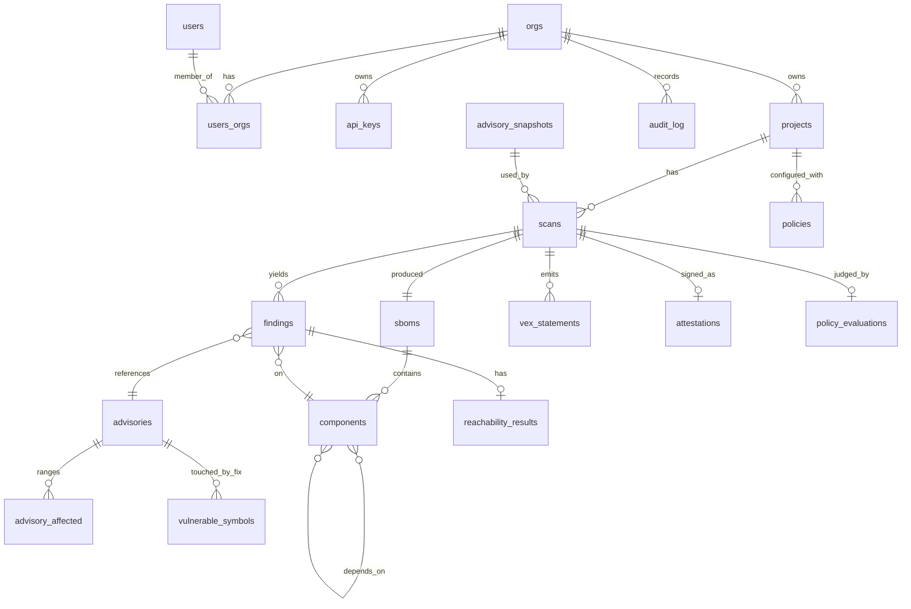

# 02 · Data Model

Postgres 16. Pydantic v2 models in `core` mirror these tables one-to-one so that CLI JSON output, API payloads and database rows share a schema. Identifiers are ULIDs stored as `text` (sortable, URL-safe). Timestamps are `timestamptz`. All tenant-owned tables carry `org_id` and are protected by row-level security.

## 1. Entity overview



## 2. Global (non-tenant) tables

### `advisories`
One row per deduplicated advisory. Aliases collapse to a single primary id (prefer `CVE-*`, then `GHSA-*`, then ecosystem id).

| column | type | notes |
|---|---|---|
| id | text PK | primary identifier, e.g. `CVE-2024-3651` |
| aliases | text[] | all known ids |
| summary | text | |
| details | text | Markdown from source |
| published_at / modified_at | timestamptz | from source |
| withdrawn_at | timestamptz null | |
| cvss_v3 | jsonb null | vector + base score |
| cvss_v4 | jsonb null | |
| severity | text | normalised: CRITICAL/HIGH/MEDIUM/LOW/UNKNOWN |
| epss_score / epss_percentile | numeric null | refreshed daily |
| kev | boolean | in CISA Known Exploited Vulnerabilities |
| kev_added_at | date null | |
| cwe_ids | text[] | |
| references | jsonb | `[{type, url}]` as in OSV |
| repo_url | text null | upstream repository inferred from references/ranges |
| symbols_status | text | `pending` / `extracted` / `derived_from_tags` / `none` / `failed` |
| symbols_detail | text null | why extraction ended where it did, in plain language |
| symbols_attempts | smallint | extraction reaches the network, so attempts are counted and capped |
| symbols_attempted_at | timestamptz null | |
| source_hash | text | hash of the normalised source record, for change detection |

Partial index `(symbols_attempts, modified_at) WHERE symbols_status IN
('pending', 'failed')` is the extraction work queue. Most rows leave it
permanently once extracted, so indexing only the ones still waiting keeps it
small as the corpus grows.

`symbols_status = 'none'` is terminal: extraction ran and legitimately found
nothing, such as a data-only fix or a malicious-package record. Only `pending`
and `failed` are retried, and only while `symbols_attempts` is below the cap. A
fix commit in a deleted repository fails identically forever, and without the
cap it would be retried on every run while advisories never tried once waited
behind it.

### `advisory_affected`
Affected package ranges. One advisory may affect several packages.

| column | type | notes |
|---|---|---|
| id | text PK | |
| advisory_id | FK advisories | |
| ecosystem | text | OSV ecosystem name (`PyPI`, `npm`, …) |
| package_name | text | canonical (PEP 503 normalised for PyPI) |
| purl_base | text | `pkg:pypi/requests` |
| ranges | jsonb | OSV `ranges[]` verbatim (`ECOSYSTEM`, `SEMVER`, `GIT`) |
| versions | text[] | OSV explicit affected versions when present |
| fixed_versions | text[] | derived, for upgrade suggestions |

Index: `(ecosystem, package_name)`.

### `vulnerable_symbols`
Functions/methods/classes modified by an advisory's fix. The heart of reachability.

| column | type | notes |
|---|---|---|
| id | text PK | |
| advisory_id | FK advisories | |
| ecosystem | text | |
| package_name | text | |
| symbol | text | fully qualified: `requests.adapters.HTTPAdapter.send` |
| file_path | text | path in upstream repo at fix commit |
| kind | text | `function` / `method` / `class` / `module` |
| source | text | `fix_commit` / `tag_diff` / `curated` / `osv_ecosystem_specific` / `manual` |
| fix_commit | text null | sha |
| confidence | text | `high` (direct hunk inside body) / `medium` (signature or decorator changed) / `low` (file-level only, tag diff) |
| created_at | timestamptz | |

Unique: `(advisory_id, package_name, symbol)`. Curated overrides (`source = 'curated'`) win over extracted ones and are maintained in-repo as YAML in `testdata/advisories/curated/`. Re-extraction replaces a symbol's row rather than duplicating it: a better builder may read different symbols out of the same diff.

`source = 'manual'` is a symbol an operator named during triage, for an
advisory with no recoverable fix commit. It is the least trustworthy
provenance, not because the person is likely wrong but because nothing checked
them, and it carries low confidence for that reason.

### `advisory_snapshots`
Immutable record of the advisory corpus at a point in time so scans are reproducible.

| column | type | notes |
|---|---|---|
| id | text PK | |
| created_at | timestamptz | |
| content_hash | text | hash over all `advisories.source_hash` sorted |
| core_version | text null | the build that normalised these records |
| ecosystems | text[] | |
| counts | jsonb | per ecosystem: advisories, with_symbols |

The content hash covers the *normalised* records, not the bytes OSV served, so
improving normalisation changes the hash of a corpus that never moved. Without
`core_version` that is indistinguishable from corruption, and reporting it as
corruption sends a reader hunting for damage that is not there.

### `package_callgraphs`
Cache index for dependency call graphs stored in object storage.

| column | type | notes |
|---|---|---|
| ecosystem, package_name, version | text | composite PK |
| builder_version | text | bump invalidates |
| object_key | text | R2/MinIO key of the serialised graph |
| node_count / edge_count | int | |
| unresolved_call_ratio | numeric | share of call sites the resolver could not bind; quality signal |
| built_at | timestamptz | |
| status | text | `ready` / `building` / `failed` |

## 3. Tenant tables

### `orgs`, `users`, `users_orgs`, `api_keys`
Standard. `api_keys.key_hash` is SHA-256 of the secret; the secret is shown once. Roles: `owner`, `member`.

`users` has no password column. GitHub is the only identity provider, the
account is keyed on `(provider, provider_subject)`, and the login is display
only: a GitHub login can be renamed and the name claimed by somebody else, so
keying on it would eventually sign one person into another person's account.

### `sessions`
A browser credential, deliberately separate from `api_keys`. Only
`token_hash` (SHA-256 of the cookie value) is stored, `expires_at` is absolute
and not nullable, and `org_id` is the organisation the session is *currently*
acting as — switching organisation is an update to this row rather than a new
sign-in. Resolved on the owner's connection, like an API key, because
resolving the credential is how the organisation is discovered.

### `projects`
| column | type | notes |
|---|---|---|
| id | text PK | |
| org_id | FK orgs | |
| slug | text | unique per org |
| repo_url | text null | |
| default_branch | text | |
| visibility | text | `private` / `public` |
| entry_points | jsonb | overrides from `.vexpath.yml` |
| settings | jsonb | |

### `scans`
| column | type | notes |
|---|---|---|
| id | text PK | |
| org_id, project_id | FK | |
| mode | text | `cli` / `action` / `hosted` |
| git_ref, git_sha | text null | |
| advisory_snapshot_id | FK advisory_snapshots | reproducibility |
| core_version | text | version of `vexpath_core` that produced the verdicts |
| status | text | `queued` / `running` / `completed` / `failed` |
| summary | jsonb | counts by verdict × severity, for fast listing |
| diff_vs_previous | jsonb | `{new_reachable: [...], resolved: [...], newly_unreachable: [...]}` |
| started_at / finished_at | timestamptz | |

### `sboms`
| column | type | notes |
|---|---|---|
| id | text PK (= scan id) | one SBOM per scan |
| org_id | FK | |
| format | text | `cyclonedx-1.6-json` / `spdx-2.3-json` / … |
| object_key | text | original document in object storage |
| document_hash | text | sha256 |
| generated_by | text | `vexpath` / `syft` / `uploaded` |
| component_count | int | |

### `components`
Normalised components of one SBOM.

| column | type | notes |
|---|---|---|
| id | text PK | |
| org_id, sbom_id | FK | |
| purl | text | canonical |
| ecosystem, name, version | text | denormalised from purl |
| bom_ref | text | original ref in document |
| direct | boolean | direct dependency of the project |
| scope | text | `runtime` / `dev` / `optional` |
| licenses | text[] | SPDX ids |
| hashes | jsonb | |

### `component_edges`
`(sbom_id, parent_component_id, child_component_id)`: the dependency graph, needed to explain *why* a transitive package is present.

### `findings`
One row per (component, advisory) in a scan.

| column | type | notes |
|---|---|---|
| id | text PK | |
| org_id, scan_id, component_id | FK | |
| advisory_id | FK advisories | |
| severity | text | copied at scan time (advisories change) |
| epss_score, kev | | copied at scan time |
| fixed_in | text null | nearest fixed version |
| verdict | text | `affected` / `not_affected` / `under_investigation` / `fixed` |
| justification | text null | OpenVEX justification label |
| reachability_result_id | FK null | |
| first_seen_scan_id | FK scans | for `age_days` in policy |
| suppressed_by | text null | manual suppression reference (`suppressions.id`) |

### `reachability_results`
| column | type | notes |
|---|---|---|
| id | text PK | |
| org_id, finding_id | FK | |
| status | text | `reachable_confirmed` / `reachable_possible` / `unreachable` / `symbols_unknown` / `graph_incomplete` |
| reason | text null | why a non-definitive status was reached: `ecosystem_unsupported` / `no_fix_commit` / `patchdiff_failed` / `parse_errors` / `entry_points_unknown` |
| confidence | text | `high` / `medium` / `low` |
| matched_symbols | text[] | which vulnerable symbols were hit |
| shortest_path | jsonb | `[{symbol, file, line}]` from entry point to vulnerable symbol |
| path_count | int | |
| via_dynamic_edges | boolean | path depends on a conservatively-resolved dynamic call |
| graph_stats | jsonb | nodes, edges, unresolved ratio for this scan |
| explanation | text | human-readable summary rendered by core.report |

### `vex_statements`
Materialised OpenVEX statements, one per finding, plus the full document in object storage.

| column | type | notes |
|---|---|---|
| id | text PK | |
| org_id, scan_id, finding_id | FK | |
| vex_document_key | text | object storage key of the whole OpenVEX doc |
| status | text | OpenVEX status |
| justification | text null | |
| impact_statement | text null | generated from evidence |
| action_statement | text null | e.g. "upgrade to 2.32.4" |
| timestamp | timestamptz | |

### `attestations`
| column | type | notes |
|---|---|---|
| id | text PK | |
| org_id, scan_id | FK | |
| predicate_type | text | `https://cyclonedx.org/bom` / `https://openvex.dev/ns/v0.2.0` |
| subject_digest | text | sha256 of attested artefact |
| envelope_key | text | DSSE envelope in object storage |
| signer_identity | text | OIDC identity (workflow URL or email) |
| rekor_log_index | bigint null | |
| rekor_uuid | text null | |
| verified_at | timestamptz | server-side re-verification on ingest |

### `policies`
| column | type | notes |
|---|---|---|
| id | text PK | |
| org_id, project_id | FK | |
| name | text | |
| cel | text | policy source |
| version | int | incremented on change |
| source | text | `repo` (from `.vexpath.yml`) / `dashboard` |

### `policy_evaluations`
`(scan_id, policy_id, passed boolean, violations jsonb, evaluated_at)`.

### `suppressions`
Manual overrides with an expiry and a mandatory reason, scoped to project + advisory (+ optional component). Suppressions never change the *verdict*; they change the *policy outcome* and are recorded in VEX as `not_affected` with justification `inline_mitigations_already_exist` or the user-chosen label.

### `audit_log`
`(id, org_id, actor_type, actor_id, action, target_type, target_id, metadata jsonb, created_at)`. Append-only; no update/delete grants.

## 4. Object storage layout

```
{org_id}/scans/{scan_id}/sbom.{json|xml}
{org_id}/scans/{scan_id}/openvex.json
{org_id}/scans/{scan_id}/cdx-vex.json
{org_id}/scans/{scan_id}/attestation.intoto.jsonl
{org_id}/scans/{scan_id}/callgraph.first-party.msgpack
global/callgraphs/{ecosystem}/{package}/{version}/{builder_version}.msgpack
global/advisory-snapshots/{snapshot_id}.jsonl.zst
```

## 5. Retention

- Scans and their artefacts: unlimited on paid plans; last 90 days or last 50 scans on the free tier, whichever is larger.
- Advisory snapshots: forever (small, compressed).
- Call-graph caches: least-recently-used eviction above a storage budget.
- Audit log: forever.
