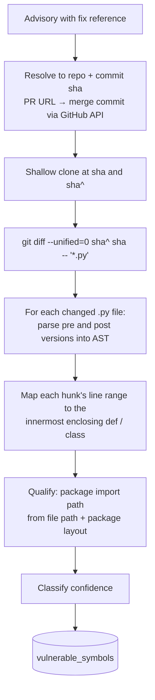

# 03 · Reachability Analysis Design

This is the core of the product. Everything else can be bought or copied; this is what makes a verdict defensible.

## 1. The question we answer

Given:
- an application `A` (first-party source + lockfile),
- a finding `(component C at version V, advisory X)`,
- the set `S_X` of *vulnerable symbols*: functions/methods in `C` that the fix for `X` modified,

decide whether any symbol in `S_X` can execute when `A` runs, and produce evidence either way.

We decide this with a **static, whole-program call graph** spanning `A` and the exact dependency versions in its lockfile, and a graph search from `A`'s entry points to `S_X`.

## 2. Why a fix-commit diff defines "vulnerable code"

Advisories rarely say which function is vulnerable. They do almost always point at the commit that fixed it. The functions whose bodies that commit changed are, with high precision, where the vulnerable logic lived or where the guard was added. This is the same heuristic the commercial reachability vendors use and is the approach of academic datasets (e.g. the vulnerable-function datasets derived from VulnCode-DB/CVEfixes). Its known weaknesses:

- Fixes sometimes add a *new* guard in a caller rather than editing the vulnerable function. Then the modified symbol is the right boundary anyway: if you can reach the caller, you can reach the bug.
- Fixes bundled with refactors touch unrelated functions. This inflates `S_X` and biases towards `reachable`, which is the safe direction.
- Some fixes change only data (regexes, constants, dependency pins). Then no symbol is extracted and the finding is `symbols_unknown`.

Erring toward *reachable* is deliberate (Blueprint § 6, principle 3).

## 3. Vulnerable-symbol extraction (`advisory.patchdiff` job)



Details:

- **Package root detection.** Read `pyproject.toml`, `setup.cfg` or `setup.py` at the fix commit to find `packages` or `package_dir`; otherwise infer from `__init__.py` chains. Map `src/requests/adapters.py` to `requests.adapters`. `setup.py` is parsed with `ast`, never executed.
- **Enclosing definition.** Walk the AST; the symbol is the deepest `FunctionDef`/`AsyncFunctionDef` whose `[lineno, end_lineno]` contains the hunk. If the hunk is inside a class body but outside any method, the symbol is the class. If at module level, the symbol is the module (kind `module`), which means "importing this module executes the changed code".
- **Deleted functions** (present only pre-fix) are recorded from the pre-AST.
- **Renames/moves**: `git diff -M` similarity detection; the pre-fix name is kept because the vulnerable version has that name.
- **Confidence.**
  - `high`: hunk lines inside a function body.
  - `medium`: only signature, decorators or docstring changed; or symbol derived from a PR whose merge commit includes multiple commits.
  - `low`: derived from tag-to-tag diff (no explicit fix commit); or more than 25 symbols extracted (likely a refactor), in which case we keep them all but flag the advisory for curation.
- **Tests excluded.** Files under `tests/` or `test/`, and files matching `test_*.py` or `*_test.py`, never produce symbols.
- **Version applicability.** Symbols are attached to the advisory, and checked against the *affected* version at scan time: if the symbol does not exist in the installed version's call graph (renamed earlier, for instance), we fall back to module-level reachability for that package and report `confidence = low`.

Output coverage target (tracked metric): share of PyPI advisories with at least one `high` or `medium` confidence symbol. Published literature and vendor data suggest 60 to 75 % is attainable for PyPI; below 50 % the curated-overrides path becomes a priority.

## 4. Call-graph construction

### 4.1 Two graphs, linked

1. **Dependency package graphs**: one per `(ecosystem, package, version)`, built once in the `callgraph.build` worker from the downloaded archive and cached globally. Nodes are fully qualified symbols; edges are calls and imports *inside the package*, plus **external call sites** recorded as unresolved references to `other_package.module.symbol`.
2. **First-party graph**: built per scan on the user's machine or in the sandbox from the repository's own source.

At scan time, the first-party graph is linked to the dependency graphs by resolving import statements against the lockfile's exact versions, and dependency graphs are linked to each other the same way. Linking is a lookup, not a rebuild, so warm scans are fast.

### 4.2 Python builder (ADR-0008)

Own implementation on top of `ast`, inspired by PyCG's design but written for determinism and conservative resolution:

1. **Module discovery**: enumerate `.py` files, compute dotted names from the package layout; respect namespace packages.
2. **Definitions pass**: collect every function, class, method and module-level assignment, with line spans.
3. **Scope and import resolution**: build per-module symbol tables; resolve `import x.y`, `from x import y as z`, relative imports, `__all__`, and re-exports through `__init__.py`.
4. **Assignment-flow pass (light type inference)**: track `name = Class(...)`, `name = module.func`, attribute assignments on `self` inside `__init__`, and function return types when the return is a direct constructor call. This resolves the common `client = Session(); client.get(...)` pattern that naive builders miss.
5. **Call edges**: for each `Call` node, resolve the callee to one or more definitions:
   - direct name or attribute chain → exact edge;
   - method on an inferred class → edge to that class's method, plus to overriding methods in known subclasses (class-hierarchy analysis);
   - method on an *unknown* receiver → **conservative edge**: if the attribute name matches a method name defined in any package already imported by that module, add edges to all of them, marked `dynamic`;
   - `getattr`, `importlib.import_module`, `__import__`, `eval`, `exec` → mark the enclosing function as `opaque`; any opaque function is treated as reaching every symbol of every package it imports.
6. **Framework entry points** (see § 4.4).
7. **Decorators** are modelled as calls at definition time (so a `@app.route` decorator both registers an entry point and is itself a call edge into the framework).

The output per module is a compact adjacency list serialised with msgpack; symbol ids are interned strings.

### 4.3 Other ecosystems

Python is the only ecosystem with reachability analysis in v1 (ADR-0012). Components from every other ecosystem still flow through SBOM handling, matching, VEX, attestation and policy; their findings carry `status = symbols_unknown` with the reason `ecosystem_unsupported`, which maps to OpenVEX `under_investigation`. The UI and the report show a capability note next to those findings so nobody reads "under investigation" as "checked and safe".

The two-level design (per-package graphs plus link-time resolution) and the search layer are deliberately language-neutral. Adding an ecosystem means writing one builder, not reworking the pipeline. The next one planned is Go, by importing `govulncheck` output rather than writing an analyser.

### 4.4 Entry points

Everything reachable must start somewhere. Default entry points, in priority order:

1. Explicit `entry_points` in `.sscp.yml` (dotted symbols or file globs).
2. `[project.scripts]` / `console_scripts` / `package.json` `bin` and `main`.
3. `if __name__ == "__main__":` blocks and `__main__.py`.
4. Framework handlers: FastAPI and Flask routes, Django URL confs, management commands and signal receivers, Celery tasks, Click and Typer commands, AWS Lambda handlers (`handler` in files referenced by `serverless.yml` or `template.yaml`), ASGI/WSGI application objects. Test functions and pytest fixtures are excluded.
5. **Fallback**: every public function in every first-party module. This over-approximates and is reported as `confidence = medium` with an explanation that entry points were inferred.

Module-level code of every imported first-party module is always an entry point (imports execute it).

### 4.5 What we never do

- Import or execute the user's code or dependencies.
- Rely on installed `site-packages` on the hosted platform; graphs come from archives. Locally, the CLI *may* read the active virtualenv's `site-packages` as a fast path to find exact versions, still without importing anything.

## 5. Verdict rules

For a finding with vulnerable-symbol set `S` and search result `R` (set of paths from entry points to `S`):

| Condition | `reachability_results.status` | OpenVEX status | Justification |
|---|---|---|---|
| `S` non-empty, a path exists using only resolved edges | `reachable_confirmed` | `affected` | – |
| `S` non-empty, paths exist but every path uses a `dynamic` edge or passes through an `opaque` function | `reachable_possible` | `affected` | – (impact statement explains uncertainty) |
| `S` non-empty, package is imported, no path to `S` | `unreachable` | `not_affected` | `vulnerable_code_not_in_execute_path` |
| Package present in SBOM but never imported by any reachable module | `unreachable` | `not_affected` | `vulnerable_code_not_present` is **not** used (the code is present); we use `vulnerable_code_not_in_execute_path` and the impact statement says "never imported" |
| `S` empty (`symbols_status` = `none`/`failed`) and package is reachable | `symbols_unknown` | `under_investigation` | – |
| `S` empty and package is never imported | `unreachable` | `not_affected` | `vulnerable_code_not_in_execute_path` |
| First-party graph incomplete (parse errors > 5 % of files, or entry-point fallback *and* `S` non-empty with no path) | `graph_incomplete` | `under_investigation` | – |
| Installed version is not in the affected range (matcher disagrees with SBOM metadata) | – | `fixed` | – |

Two asymmetries are intentional:
- **Blocking** (policy fail) may be triggered by `reachable_possible`; **suppressing** (automatic `not_affected`) is only ever produced by `unreachable`, never by uncertainty.
- Module-level vulnerable symbols make "imported" equal to "reached".

Confidence is reported alongside status:

| confidence | meaning |
|---|---|
| `high` | explicit entry points, resolved edges only, symbols from fix commit with `high` confidence |
| `medium` | inferred entry points, or `medium` symbols, or class-hierarchy edges |
| `low` | `dynamic` edges on the path, `low`-confidence symbols, or symbols resolved only at module level |

## 6. Evidence

Every result stores the **shortest path** (BFS over the linked graph) as a list of `{symbol, file, line}` plus the total path count. The report renders it as:

```
CVE-2024-35195 · requests 2.31.0 · HIGH · reachable (confirmed, high)
  app/main.py:42            fetch_upstream()
  → app/http.py:17          Session.get()  [requests.sessions.Session.get]
  → requests/sessions.py    Session.request()
  → requests/sessions.py    Session.send()
  → requests/adapters.py    HTTPAdapter.send()   ← vulnerable symbol (fix 2d8df8b)
Suggested action: upgrade requests to ≥ 2.32.0
```

For `unreachable`, evidence is the set of symbols searched, the entry points used, and the statement that no path exists, so the VEX `impact_statement` is self-contained:

> `requests.adapters.HTTPAdapter.send` (modified in fix commit 2d8df8b) is not reachable from the 14 detected entry points of this application. The package is imported by `app/http.py` but only `requests.utils.quote` is called.

## 7. Performance design

- Dependency graphs are cached globally and fetched in parallel; a 500-package lockfile is ~500 small msgpack downloads or a single bundled fetch (`POST /v1/callgraphs/bundle`).
- First-party graph build is linear in source size; typical repos parse in under 10 seconds.
- Reachability is one multi-source BFS from all entry points producing a reachable set; each finding is then a set-intersection with its `S`. Paths are reconstructed lazily only for `affected` findings and on demand for others.
- Budget: 5 minutes for 500 dependencies, warm cache, free-tier CPU. Cold-cache builds of popular packages happen in the background worker and are pre-warmed for the top 2,000 PyPI and npm packages.

## 8. Validation and benchmarking

Reachability claims must be measured, not asserted.

- **Fixture repos** (`testdata/repos/`): minimal projects with hand-constructed reachable and unreachable usages of real vulnerable versions, covering direct calls, method chains, subclass overrides, dynamic dispatch, conditional imports, unused transitive deps, and module-level vulnerabilities. Every verdict rule in § 5 has at least one fixture.
- **Benchmark set**: 30 public Python repositories pinned at commits with known CVEs. Verdicts are manually reviewed once and frozen as expected results; CI compares against them and fails on any `not_affected` that was expected `affected` (zero tolerance) and on more than 10 % drift elsewhere.
- **Symbol-extraction coverage** reported per advisory sync run.
- **Dynamic cross-check** (post-v1): optional upload of `coverage.py` data from a user's test run; any vulnerable symbol that appears in executed lines is `reachable_confirmed` regardless of the static result, and discrepancies feed back into builder improvements.

## 9. Known limitations to document publicly

- Reflection-heavy code (plugin systems, Django settings-driven imports) yields `reachable_possible` broadly.
- Vulnerabilities in C extensions (e.g. in `cryptography`, `pillow`) are mapped to the Python wrapper functions that call into the extension when the fix touches them; if the fix is C-only, the result is `symbols_unknown`.
- Vulnerabilities whose trigger is *data* (malicious input to any entry point of the package) are handled correctly only when the fix touched the parsing function, which is usually the case.
- Build-time-only dependencies are classified `scope = dev` and excluded from policy by default, not from analysis.
