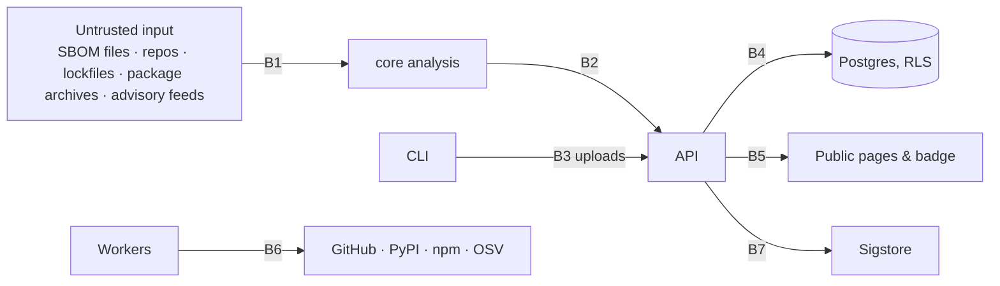

# 06 · Threat Model

A security product that is itself insecure is worse than no product. This document follows a lightweight STRIDE pass over each trust boundary. It is reviewed at the end of every milestone.

## 1. Assets

1. Customer source code (hosted scans only) and SBOMs (reveal the full dependency inventory, valuable to attackers).
2. Verdicts and VEX documents: integrity matters more than confidentiality. A forged `not_affected` is the worst outcome.
3. Signing identities and Rekor entries.
4. The advisory and vulnerable-symbol corpus: poisoning it changes verdicts for every user.
5. API keys, GitHub App installation tokens, OAuth sessions.
6. The badge: a public, cacheable claim about a project's security.

## 2. Trust boundaries

## 3. Threats and controls

### B1 · Untrusted content into the analysis core

| Threat | Control |
|---|---|
| Malicious SBOM (XML entity expansion, billion-laughs, oversized JSON) | `defusedxml` for XML; streaming JSON size cap (25 MB); schema validation before any processing; reject documents with more than 50,000 components |
| Malicious repository or package archive (zip bombs, path traversal in tarballs, symlink escapes) | Extract with path normalisation and symlink rejection; uncompressed size cap; extraction into a tmpfs with a quota |
| Code execution via analysis | **Static analysis only.** `ast.parse` builds trees without executing anything. No `pip install`, no `import` of analysed modules, no `setup.py` execution. Package metadata is read from `pyproject.toml`, `setup.cfg` and `package.json` with TOML, INI and JSON parsers; `setup.py` is parsed as an AST, never run. |
| Pathological inputs (deeply nested ASTs, huge files) | `sys.setrecursionlimit` bounded and iterative traversal where possible; per-file size cap 5 MB; per-scan CPU and wall-clock limits; worker runs as unprivileged user in a container with `--read-only`, `--cap-drop ALL`, no network after dependency fetch, memory limit |
| Advisory feed poisoning (compromised mirror) | Fetch OSV from the official GCS bucket and API over TLS; verify GHSA via authenticated GraphQL; record source hashes; curated symbols only from this repo, reviewed via PR |

### B2/B3 · CLI uploads to the API

| Threat | Control |
|---|---|
| Forged results ("I ran the scan, trust me, everything is unreachable") | Uploaded results are labelled by `mode`; attestation signatures are **re-verified server-side** against Rekor and the stated identity; the public report shows the signer identity and whether verification passed. Unsigned uploads are shown as "self-reported". |
| Contributed call graphs poisoned to hide edges | `PUT /callgraphs/...` only *requests* a build; the server rebuilds from the official archive and publishes its own output. Client graphs are never served to others. |
| API key leakage | Keys prefixed `sscp_live_` so secret scanners can detect them; GitHub secret-scanning partner registration post-launch; hashed at rest; rotation and last-used tracking; scoped to one org |
| Oversized or abusive uploads | Size caps, rate limits per key, per-org storage quotas |

### B4 · Database

| Threat | Control |
|---|---|
| Cross-tenant data access through a missed `WHERE org_id` | Row-level security on every tenant table, enforced by Postgres, with the API connecting as a role that cannot bypass RLS; automated negative tests per table in CI |
| SQL injection | Parameterised queries via SQLAlchemy Core; no string-built SQL |
| Migration mistakes dropping data | Migrations reviewed; production migrations run with a pre-step logical backup; destructive migrations split into expand/contract |

### B5 · Public pages and badge

| Threat | Control |
|---|---|
| Badge claims for a stale or tampered scan | Badge derives from the latest *verified* scan on the default branch; shows "unknown" if the last scan is older than 30 days; cache TTL 5 minutes; ETag |
| Cache poisoning via query parameters | Badge accepts only an allow-listed `style` parameter; everything else is stripped before caching |
| Information leakage from private projects via public endpoints | Public endpoints use a separate read-only database role restricted by RLS to `visibility = 'public'`; private project slugs return the same 404 as non-existent ones |
| XSS from advisory text (Markdown from upstream) or from SBOM-supplied strings (component names, licences, purls) | Jinja2 autoescaping on for every template; advisory Markdown rendered then passed through a sanitiser with a strict tag allow-list; raw HTML never emitted; a Content-Security-Policy header with no `unsafe-inline` (the vendored HTMX asset is served from the same origin) |
| SEO abuse (spam projects made public) | Public pages for free-tier orgs require a verified GitHub repository that the org owns (GitHub App installation or OAuth-confirmed ownership) |

### B6 · Workers fetching from the internet

| Threat | Control |
|---|---|
| SSRF via attacker-controlled `repo_url` or advisory reference URLs | Allow-list of hosts (github.com, gitlab.com, bitbucket.org, pypi.org, files.pythonhosted.org, registry.npmjs.org, osv.dev, api.github.com); DNS resolution checked against private ranges; no redirects followed across hosts |
| Credential exposure to cloned repos (git hooks) | Clone with `--no-checkout` then `git checkout` with hooks disabled (`core.hooksPath=/dev/null`); tokens passed via `GIT_ASKPASS` helper, never on the command line |
| Dependency confusion in analysis environment | Workers install nothing at scan time; their own dependencies are pinned with hashes |

### B7 · Signing

| Threat | Control |
|---|---|
| Signing with an unintended identity | Keyless only in CI; the identity is the workflow URL and is displayed; local signing requires interactive OIDC login and is labelled "developer-signed" |
| Replay of an old attestation onto a new SBOM | Subject digest binds the statement to the exact artefact; verification checks digest, identity, issuer and Rekor inclusion |
| Dependence on Sigstore availability | Signing failure is reported, never silently skipped; scans still complete with `attestation = none` and the policy can require signing |

## 4. Platform hygiene

- Dependencies of this project pass through this project (dogfooding) plus Dependabot; releases have SLSA provenance.
- Secrets in GitHub Actions use OIDC federation to cloud providers wherever possible instead of long-lived keys.
- Security policy (`SECURITY.md`) with a disclosure address and a 90-day coordinated-disclosure commitment.
- Audit log is append-only; database role used by the API has no DELETE on it.
- Logs never contain SBOM contents, source code, or API keys (structured logging with field-level redaction).

## 5. Residual risks accepted for v1

- Static analysis cannot prove the absence of reachability under arbitrary reflection; this is mitigated by confidence tiers and conservative edges, not eliminated.
- Free-tier hosting has no SLA; the CLI works without the platform, which is the fallback.
- Advisory data freshness depends on upstream feeds (OSV typically lags NVD by hours); the snapshot id makes this visible.
